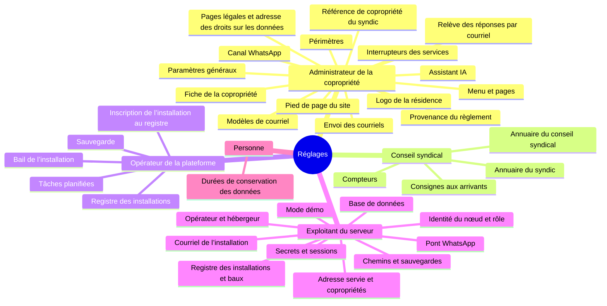

<!-- GÉNÉRÉ par `python scripts/ci/carte_reglages.py --ecrire` — ne pas éditer. -->

# Carte des réglages

Qui règle quoi, où, et où la valeur vit — pour chaque réglage de l'application.
Ce document est **généré** depuis le code (`api/app/utils/reglages_carte.py`, la
liste blanche `api/app/utils/reglages.py`, le registre des services, les usages de
l'IA et `Settings`) : la CI le régénère et échoue s'il diffère. Un réglage neuf se
déclare dans le registre, pas ici. Ce qu'on ne peut pas y ranger fait échouer le test.

L'**accès** de chaque notion est confronté, en CI, à la dépendance d'autorisation
que sa route prend réellement : le tableau dit ce que fait le serveur, pas ce que
l'écran laisse espérer. Les écarts connus entre les deux sont listés plus bas.

> Les **groupes cibles** sont ceux que propose la réorganisation d'Admin (#2062) :
> une **proposition**, tant que la maquette n'est pas validée.

## Vue d'ensemble

## Qui règle quoi

### Administrateur de la copropriété

| Notion | Écran aujourd'hui | Stockage | Route | Groupe cible proposé (#2062) |
|---|---|---|---|---|
| Paramètres généraux : e-mail et gestionnaire du site, délais d'archivage et de relance, notifications | Admin › Paramétrage site | config_site | `PUT /config` | 🏢 Copropriété › Fonctionnement |
| Pied de page du site | Admin › Paramétrage site (pied de page) | config_site | `PUT /config` | 🎨 Présentation › Connexion et pied de page |
| Pages légales et adresse des droits sur les données | Admin › Pages légales | config_site | `PUT /config` | 🏢 Copropriété › Pages légales |
| Référence de copropriété du syndic | Admin › Fiche copropriété | config_site | `PUT /config` | 🏢 Copropriété › Identité |
| Menu et pages : ordre, icône, libellé, titre, description | Admin › Descriptif pages | config_site | `PUT /config` | 🎨 Présentation › Menu et pages |
| Interrupteurs des services | Admin › Services | config_site | `PUT /config` | 🔌 Services › Services |
| Envoi des courriels (SMTP) et signature | Admin › SMTP | config_site | `PUT /config` | 🔌 Services › Courriel |
| Relève des réponses par courriel (IMAP) | Admin › SMTP | config_site | `PUT /config` | 🔌 Services › Courriel |
| Canal WhatsApp : pont, groupe, pied des messages | Admin › WhatsApp | config_site | `PUT /config` | 🔌 Services › WhatsApp |
| Assistant IA : fournisseur, clé, réglage de chaque usage | Admin › Assistant IA | config_site | `PUT /config` | 🔌 Services › Assistant IA |
| Logo de la résidence | Admin › Paramétrage site | fichier + config_site (`site_logo`) | `POST /config/logo` | 🏢 Copropriété › Identité |
| Fiche de la copropriété : identité, adresse, syndic, références | Admin › Fiche copropriété ; Ma résidence | table `copropriete` (+ `config_site.site_nom`) | `PATCH /copropriete` | 🏢 Copropriété › Identité |
| Périmètres (arbre des bâtiments et espaces) et leurs accès fixes | Admin › Périmètres | table `perimetre` | `PATCH /perimetres/{perimetre_id}` | 🏢 Copropriété › Périmètres |
| Modèles de courriel | Admin › Modèles e-mail | table `modele_email` | `PATCH /admin/modeles-email/{modele_id}` | 🎨 Présentation › Modèles e-mail |
| Provenance du règlement | Admin › Assistant IA | table / `config_site` | `PUT /reglement/provenance` | 🔌 Services › Assistant IA |

### Conseil syndical (ou administrateur)

| Notion | Écran aujourd'hui | Stockage | Route | Groupe cible proposé (#2062) |
|---|---|---|---|---|
| Annuaire du syndic | Espace CS › Annuaire CS & Syndic | table / `config_site` | `PUT /admin/annuaire/syndic` | — (hors Admin) |
| Annuaire du conseil syndical (composition) | Espace CS › Annuaire CS & Syndic | table / `config_site` | `PUT /admin/annuaire/cs` | — (hors Admin) |
| Consignes aux arrivants | Espace CS › Annuaire CS & Syndic (consignes aux arrivants) | `config_site.consignes_arrivant` | `PUT /admin/consignes-arrivant` | — (hors Admin) |
| Compteurs (relevés) | Espace CS › Compteurs (configuration des catégories) | table `compteur_config` | `POST /prestataires/compteurs-config` | — (hors Admin) |

### Opérateur de la plateforme

| Notion | Écran aujourd'hui | Stockage | Route | Groupe cible proposé (#2062) |
|---|---|---|---|---|
| Sauvegarde : heure et nombre de versions conservées | Admin › Maintenance | table `config_sauvegarde` | `PUT /admin/sauvegardes/config` | 🛠 Exploitation › Installation |
| Inscription de l'installation au registre | Admin › Maintenance | volume `installation` (clé et état d'inscription) | `POST /admin/installation/inscription` | 🛠 Exploitation › Installation |
| Bail de l'installation | Admin › Maintenance | volume `installation` | `POST /admin/installation/bail` | 🛠 Exploitation › Installation |
| Registre des installations (décisions, services, distribution) — sur la référence | Admin › Installations | base `plateforme` | `PUT /admin/installations/{identifiant}/services` | 🛠 Exploitation › Installations |
| Tâches planifiées : déclenchement manuel | Admin › Maintenance | `utils/taches.TACHES_PERMANENTES` (le calendrier est dans le code) | `POST /admin/maintenance/lancer` | 🛠 Exploitation › Maintenance |

### Personne (constante du code)

| Notion | Écran aujourd'hui | Stockage | Route | Groupe cible proposé (#2062) |
|---|---|---|---|---|
| Durées de conservation des données (courriels relevés, journal IA, erreurs du navigateur, comptes) | — (aucun écran) | constantes du code | — | 🏢 Copropriété › Fonctionnement (en lecture) |

## Écarts connus

- **Fiche de la copropriété** (Admin › Fiche copropriété ; Ma résidence) — Ma résidence offre la modification à tout le conseil syndical (`isCS`), mais la route est réservée à l'administrateur : un membre du CS qui enregistre reçoit un refus (#2096).

## Les clés de `config_site`

Écrites par `PUT /config` (administrateur), onglet par onglet : une clé n'appartient qu'à un seul onglet (#2057).

### Paramètres généraux — Admin › Paramétrage site

| Clé | Type | Défaut d'amorce | Lisible sans connexion |
|---|---|---|---|
| `archivage_delai_jours` | nombre | — | non |
| `login_sous_titre` | texte | `Votre espace numérique de résidence` | oui |
| `notify_new_user_created_email` | oui/non (`1`/`0`) | `0` | non |
| `notify_ticket_bug_email` | oui/non (`1`/`0`) | `0` | non |
| `relance_syndic_delai_jours` | nombre | — | non |
| `site_email` | texte | `admin@example.com` | non |
| `site_manager_user_id` | nombre | vide | non |

### Pied de page du site — Admin › Paramétrage site (pied de page)

| Clé | Type | Défaut d'amorce | Lisible sans connexion |
|---|---|---|---|
| `pied_de_page_annee_debut` | nombre | — | oui |
| `pied_de_page_masques` | JSON | — | oui |
| `pied_de_page_ordre` | JSON | — | oui |
| `pied_de_page_prefixe_nom` | texte | — | oui |
| `pied_de_page_texte` | texte | — | oui |

### Pages légales et adresse des droits sur les données — Admin › Pages légales

| Clé | Type | Défaut d'amorce | Lisible sans connexion |
|---|---|---|---|
| `contact_donnees_personnelles` | texte | — | non |
| `mentions_legales` | texte | texte du produit (seed) | non |
| `politique_confidentialite` | texte | texte du produit (seed) | non |

### Référence de copropriété du syndic — Admin › Fiche copropriété

| Clé | Type | Défaut d'amorce | Lisible sans connexion |
|---|---|---|---|
| `reference_copro` | texte | vide | non |

### Menu et pages — Admin › Descriptif pages

| Clé | Type | Défaut d'amorce | Lisible sans connexion |
|---|---|---|---|
| `pages_order` | JSON | — | oui |
| `page_config_<page>` | JSON | — | oui |

### Interrupteurs des services — Admin › Services

| Clé | Type | Défaut d'amorce | Lisible sans connexion |
|---|---|---|---|
| `conservation_affaires_active` | texte | — | non |
| `imap_enabled` | texte | — | non |
| `llm_actif` | texte | — | non |
| `verification_version_active` | texte | — | non |
| `whatsapp_enabled` | texte | — | non |

### Envoi des courriels — Admin › SMTP

| Clé | Type | Défaut d'amorce | Lisible sans connexion |
|---|---|---|---|
| `email_footer` | texte | vide | non |
| `smtp_enabled` | oui/non (`1`/`0`) | — | non |
| `smtp_from` | texte | — | non |
| `smtp_from_affaires` | texte | — | non |
| `smtp_from_name` | texte | — | non |
| `smtp_from_reponse` | texte | — | non |
| `smtp_password` | secret | — | non |
| `smtp_port` | nombre | — | non |
| `smtp_server` | texte | — | non |
| `smtp_ssl_tls` | oui/non (`1`/`0`) | — | non |
| `smtp_starttls` | oui/non (`1`/`0`) | — | non |
| `smtp_username` | texte | — | non |

### Relève des réponses par courriel — Admin › SMTP

| Clé | Type | Défaut d'amorce | Lisible sans connexion |
|---|---|---|---|
| `courriels_affiches` | nombre | — | non |
| `imap_dossier` | texte | — | non |
| `imap_password` | secret | — | non |
| `imap_plancher` | date (AAAA-MM-JJ) | — | non |
| `imap_port` | nombre | — | non |
| `imap_server` | texte | — | non |
| `imap_username` | texte | — | non |

### Canal WhatsApp — Admin › WhatsApp

| Clé | Type | Défaut d'amorce | Lisible sans connexion |
|---|---|---|---|
| `whatsapp_api_url` | texte | — | non |
| `whatsapp_footer` | texte | `— Le Conseil Syndical` | non |
| `whatsapp_group_jid` | texte | — | non |
| `whatsapp_group_name` | texte | — | non |

### Assistant IA — Admin › Assistant IA

| Clé | Type | Défaut d'amorce | Lisible sans connexion |
|---|---|---|---|
| `llm_api_key` | secret | — | non |
| `llm_api_version` | texte | — | non |
| `llm_base_url` | texte | — | non |
| `llm_delai_s` | nombre | — | non |
| `llm_envoi_document` | oui/non (`1`/`0`) | — | non |
| `llm_fournisseur` | texte | — | non |
| `llm_<usage>_actif` (8 usages) | oui/non (`1`/`0`) | — | non |
| `llm_<usage>_modele` (8 usages) | texte | — | non |
| `llm_<usage>_prompt` (8 usages) | texte | — | non |
| `llm_<usage>_max_jetons` (8 usages) | nombre | — | non |
| `llm_<usage>_appels_mois` (8 usages) | nombre | — | non |
| `llm_<usage>_appels_heure` (8 usages) | nombre | — | non |
| `llm_<usage>_prix_entree` (8 usages) | nombre décimal ($ / million de jetons) | — | non |
| `llm_<usage>_prix_sortie` (8 usages) | nombre décimal ($ / million de jetons) | — | non |
| `llm_<usage>_prix_cache` (8 usages) | nombre décimal ($ / million de jetons) | — | non |
| `llm_<usage>_effort` (8 usages) | texte | — | non |
| `llm_<usage>_coproprietaires` (1 usages) | oui/non (`1`/`0`) | — | non |

## L'environnement (`.env`) — exploitant du serveur

Les champs de `Settings` (`api/app/config.py`). Un `.env` qui porte une variable inconnue démarre quand même : elle est ignorée.

### Identité du nœud et rôle

| Variable | Type | Défaut |
|---|---|---|
| `INSTANCE_ID` | str | vide |
| `ROLE_INSTALLATION` | str | vide |
| `GIT_HASH` | str | vide |
| `COPROFIRST_VERSION` | str | vide |

### Mode démo

| Variable | Type | Défaut |
|---|---|---|
| `MODE_DEMO` | str | vide |
| `DEMO_EDITEUR` | str | vide |
| `DEMO_CONTACT` | str | vide |
| `DEMO_ADMIN_MOT_DE_PASSE` | str | secret |
| `DEMO_OPERATEUR_MOT_DE_PASSE` | str | secret |

### Registre des installations et baux

| Variable | Type | Défaut |
|---|---|---|
| `PLATEFORME_DATABASE_URL` | str | secret |
| `HOTE_REGISTRE` | str | vide |
| `CLE_SIGNATURE_BAUX` | str | secret |
| `REGISTRE_URL` | str | `https://registre.coprofirst.fr` |
| `INSTALLATION_DIR` | str | `/app/data/installation` |
| `INSTALLATION_ESSAI` | bool | `False` |

### Opérateur et hébergeur (alertes, textes légaux)

| Variable | Type | Défaut |
|---|---|---|
| `COURRIEL_OPERATEUR` | str | vide |
| `MAIL_FROM_PLATEFORME` | str | vide |
| `OPERATEUR_NOM` | str | vide |
| `OPERATEUR_ADRESSE` | str | vide |
| `OPERATEUR_CONTACT` | str | vide |
| `HEBERGEUR` | str | vide |
| `HEBERGEUR_PAYS` | str | vide |

### Adresse servie et copropriétés

| Variable | Type | Défaut |
|---|---|---|
| `ORIGIN` | str | `http://localhost` |
| `HOTES_COPROPRIETE` | str | vide |
| `COPROPRIETES_FICHIER` | str | vide |

### Secrets et sessions

| Variable | Type | Défaut |
|---|---|---|
| `SECRET_KEY` | str | secret |
| `COOKIE_SECURE` | bool | `True` |
| `ACCESS_TOKEN_EXPIRE_MINUTES` | int | `120` |
| `REFRESH_TOKEN_EXPIRE_DAYS` | int | `7` |
| `ALGORITHM` | str | `HS256` |

### Base de données

| Variable | Type | Défaut |
|---|---|---|
| `DATABASE_URL` | str | **obligatoire** |

### Courriel de l'installation (`MAIL_*`)

| Variable | Type | Défaut |
|---|---|---|
| `MAIL_ENABLED` | bool | `False` |
| `MAIL_FROM` | str | `noreply@localhost` |
| `MAIL_FROM_NAME` | str | `Ma Résidence` |
| `MAIL_USERNAME` | str | vide |
| `MAIL_PASSWORD` | str | secret |
| `MAIL_SERVER` | str | `localhost` |
| `MAIL_PORT` | int | `587` |
| `MAIL_STARTTLS` | bool | `True` |
| `MAIL_SSL_TLS` | bool | `False` |

### Chemins et sauvegardes

| Variable | Type | Défaut |
|---|---|---|
| `BACKUP_DIR` | str | `/backups` |
| `UPLOADS_DIR` | str | `/app/uploads` |
| `BACKUP_KEEP_VERSIONS` | int | `7` |
| `CACHE_MANUEL_DIR` | str | `/app/data/cache-manuel-pdf` |
| `MAINTENANCE_KEY` | str | secret |

### Pont WhatsApp

| Variable | Type | Défaut |
|---|---|---|
| `WHATSAPP_API_KEY` | str | secret |
| `WA_PHOTO_BUDGET_KO` | int | `400` |
